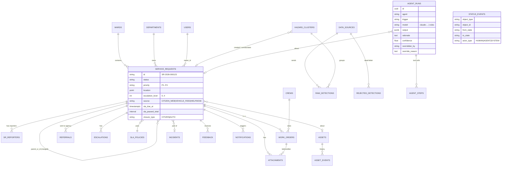
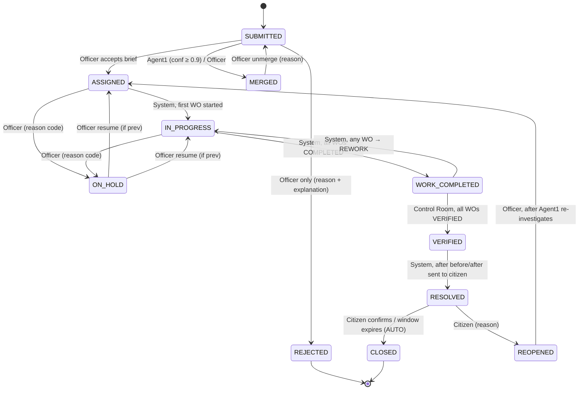
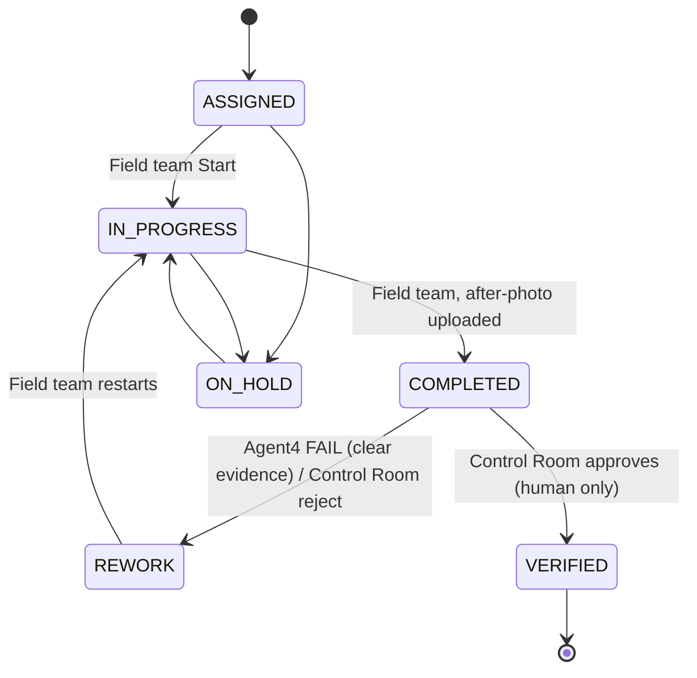

# CivicFlow — Build Plan (Step 0 / Checkpoint C0)

Status: **v2, approved direction.** The decisions below override anything later in this file.
Date: 2026-11-05

---

## 0. Team decisions (v2)

1. **Nothing for show.** Every element visible on a page must work. No demo users, no fake buttons, no placeholder numbers. If a feature isn't working by the feature freeze, it is **removed from the UI**, not shown half-built.
2. **Keep the full scope** of the original brief, including the small features (CSV export on tables, CSV import, pagination, CAPTCHA, A-/A/A+, high contrast, Kannada on citizen pages). Agent effort goes into the main scenarios, not into rare edge cases.
3. **Login:** citizens register and log in with **mobile number + password**. Staff accounts (officers, field teams, control room) are created by Control Room users through a real **Staff Management** page; the very first Control Room account is created by `dev.py seed`. Credentials never appear on any page.
4. **Partner Agency Portal** (role `AGENCY`) replaces the "Simulated Agency Inbox". BESCOM/BWSSB liaison users log in, see referrals, and reply.
5. **Notifications:** real in-app notifications (My Notifications page + Track page) and the outbox table. No SMS/WhatsApp/Telegram for now; the `SmsAdapter` interface exists but is not shown in the UI.
6. **LLM: any provider.** A provider-agnostic adapter (OpenAI-compatible: Gemini, Groq, OpenRouter, OpenAI, Ollama; plus Anthropic native), with a provider **chain** in `.env`, a JSON-mode fallback for models without tool calling, and `dev.py llm-check`. Rules fallback is always last. See CONTRACTS.md §8.
7. **Weather:** real **Open-Meteo** API (free, no key) for Bengaluru. Weather alerts can also be pushed through the ingestion API (`POST /ingest/weather-alerts`), which is what the rain test scenario uses.
8. **No government labels anywhere.** No "Government of Karnataka", no fake helpline, no state emblem. The only identity is the fictional "CivicFlow Municipal Corporation", plus a thin banner: "Student hackathon prototype — not an official website."
9. **No fake clock for the demo.** Seed data uses **real past timestamps** (e.g. a case filed 4 days ago is already at 74% of its SLA), so agents act live on genuinely aged cases. `TIME_SCALE` exists only for automated tests.
10. **Team:** **two people, two laptops, one Claude Code account each.** Lane A (Person A): backend + agents. Lane B (Person B): frontend + seed data + simulator. No other AI tools. See `TASKS.md`. Shared interfaces are in `docs/CONTRACTS.md`; rules for AI sessions are in `CLAUDE.md`.
11. **Docker only for the database during development.** The backend runs with `uvicorn` and the frontend with `npm run dev` directly on each laptop (easier to debug). The full `docker compose up` (all services) is built at the end for the judges/README.

---

## 1. Understanding of the problem

1. City corporations get thousands of civic complaints, and **routing** them to the right ward, department or outside agency is manual and slow.
2. Once routed, **follow-up** is poor: cases sit idle, BESCOM/BWSSB never reply, and nobody chases them.
3. **Citizens hear nothing** about what happened or why it's late, and some problems (potholes) are never reported at all.
4. CivicFlow puts five AI agents behind a normal-looking government grievance portal. They investigate, route, chase, verify evidence and group surges. Deterministic code enforces the rules, and humans approve every decision that affects a citizen's case.
5. We're judged on the agents (real reasoning, visible tool calls, safe autonomy) and on a demo story that runs end to end without a network or an API key.

---

## 2. Architecture

```mermaid
flowchart TB
  subgraph Web["web (React + Vite + TS)"]
    CP[Citizen Portal<br/>GIGW frame, EN/KN]
    OC[Officer Console]
    FT[Field Team<br/>mobile web]
    CR[Control Room]
    AI[Partner Agency Portal]
  end

  subgraph API["api (FastAPI modular monolith)"]
    REST[REST /api/v1 + auth + scoping]
    DOM[Domain modules<br/>complaints · workflow · work_orders · sla · wards · assets<br/>crews · referrals · notifications · media · audit · ingestion · incidents · kpi]
    WF["workflow.transition()<br/>single transition table"]
    BUS[(Event bus<br/>in-process pub/sub<br/>+ events table)]
    SCH[APScheduler<br/>follow-up tick · clustering · auto-close · surge check]
    subgraph AG[Agent layer]
      RT[Shared Agent Runtime<br/>tool registry · Claude tool-use loop · decision log<br/>rules fallback · record/replay cache · limits]
      A1[1 Case Investigator]
      A2[2 Follow-up & Escalation]
      A3[3 Road Hazard Sensing]
      A4[4 Evidence Auditor]
      A5[5 Surge Commander]
    end
    ADP[Adapters: Storage · Notification outbox · Weather (Open-Meteo) · LLM]
  end

  SIM[simulator container<br/>test data source: vehicle feed + rain scenario]
  DB[(PostgreSQL 16 + PostGIS)]
  MEDIA[/media volume/]
  CLAUDE[Any LLM provider<br/>chain, optional]

  Web --> REST --> DOM --> WF --> BUS
  BUS --> AG
  SCH --> AG
  AG --> DOM
  RT --> CLAUDE
  DOM --> DB
  ADP --> MEDIA
  SIM -- "POST /ingest/detections" --> REST
```

**The key rule:** agents never write to tables directly. Every agent "action" tool calls the same domain service a human would use (`transition()`, `create_work_order()`, `escalate()` and so on), so role checks, required fields, the audit log and events all apply to agents too. Agents are registered as a special actor type `AGENT` with an explicit list of allowed transitions. **REJECTED and CLOSED aren't on that list**, so the runtime makes it impossible for an agent to reject or close a case, rather than relying on the prompt.

---

## 3. Repo folder structure

```
lakshya/                       (repo root = CivicFlow)
├── docker-compose.yml         db · api · web · simulator  (+ e2e profile)
├── Makefile                   seed · demo · test · record · reset
├── .env.example
├── README.md  PROGRESS.md
├── docs/  BUILD_PLAN.md AGENTS.md API.md DEMO_SCRIPT.md
├── backend/
│   ├── pyproject.toml  Dockerfile  alembic.ini
│   ├── alembic/versions/
│   ├── app/
│   │   ├── main.py  config.py  db.py  clock.py  scheduler.py
│   │   ├── events/bus.py
│   │   ├── auth/            (demo login, JWT cookie, role + ward scoping deps)
│   │   ├── modules/
│   │   │   ├── complaints/  (models, schemas, service, router)
│   │   │   ├── workflow/    (transitions.py = THE table, transition())
│   │   │   ├── work_orders/ sla/ wards/ assets/ crews/ referrals/
│   │   │   ├── notifications/ media/ audit/ incidents/ kpi/
│   │   │   └── ingestion/   (API, validation, dead-letter)
│   │   ├── adapters/        storage.py sms.py weather.py agency.py llm.py
│   │   ├── agents/
│   │   │   ├── runtime/     base.py registry.py loop.py cache.py
│   │   │   │                decision_log.py dispatcher.py notify.py
│   │   │   ├── tools/       geo.py cases.py assets.py crews.py media.py hazards.py ...
│   │   │   ├── investigator/ followup/ sensing/ auditor/ surge/
│   │   │   │   (each: agent.py, prompt.md, schema.py, fallback.py)
│   │   └── seed/            seed.py  geo/*.geojson  data/*.yaml  photos/
│   ├── replay_cache/        recorded model responses (committed)
│   └── tests/
├── simulator/  Dockerfile  sim.py  scenarios/{potholes,rain}.yaml
├── web/
│   ├── Dockerfile  vite.config.ts
│   └── src/
│       ├── frame/        TopStrip Header NavBar Ticker Footer ProtoBanner Crest.svg
│       ├── components/   DataTable Fieldset Captcha Breadcrumbs SlaBadge
│       │                 Timeline MapPicker StatusPill PhotoPair StarRating
│       ├── pages/citizen/ officer/ field/ control/ agency/
│       ├── i18n/en.json kn.json
│       ├── api/client.ts
│       └── styles/       tokens.css base.css (GIGW look, no UI kit)
├── e2e/                  playwright.config.ts  happy_path.spec.ts
└── fixtures/photos/      before/after demo images (EXIF set by seed)
```

---

## 4. ER diagram (main tables)



Other tables: `users`, `departments`, `planned_works`, `sensitive_places`, `known_road_features`, `road_segments`, `inventory`, `material_requests`, `reassignment_proposals`, `audit_log` (append-only), `events`, `weather_alerts`, `review_queue`. All geometry is SRID 4326. Distance and DBSCAN queries cast to `geography`, or project to EPSG:32643 (UTM 43N) so `eps` is in metres.

`audit_log` and `status_events` get a `BEFORE UPDATE OR DELETE` trigger that raises an exception.

---

## 5. State diagrams

### Complaint (Service Request)



### Work order



Both live in `modules/workflow/transitions.py` as a list of
`Transition(obj, from_, to, roles={...}, actor_types={...}, requires=[...], side_effects=[...])`. `transition(obj, to, actor, **fields)` is the only function that writes `status`. The pytest suite is parametrised straight from this table.

The escalation level is a field (0–4) with its own `escalations` table, not a state. Escalation never touches `sla_started_at` or `sla_due_at`.

---

## 6. The agents

The same thing is true of all five: **each tool has a `kind`** of `read`, `safe_act` (reversible, allowed autonomously) or `propose` (creates a pending item for a human). Guardrail thresholds live **inside the tools**, not only in prompts. For example, `create_system_complaint` refuses a cluster with fewer than 3 distinct vehicles, and `merge_duplicate` refuses below 0.9 confidence. A creative model therefore can't break the rules.

### Agent 1: Case Investigator
| | |
|---|---|
| **Trigger** | `complaint.submitted`, `complaint.reopened` |
| **Tools** | `get_ward_for_location`, `find_nearby_assets`, `get_asset_history`, `find_nearby_open_complaints`, `get_planned_works`, `get_asset_owner`, `get_sensitive_places_nearby`, `get_vehicle_detections_nearby`, `get_sla_policy`, `get_officer_workload`, `analyze_photo`; act: `merge_duplicate` (≥0.9), `raise_p1_alert`, `create_referral_draft`, `notify_citizen` |
| **Output** | `TriageBrief{category, category_changed, priority, department_id, ward_id, suggested_officer_id, asset_id?, duplicate_of?, duplicate_confidence, repeat_failure, repeat_failure_note, planned_work_conflict?, interagency_referral?{agency, reason}, rationale[3–5], confidence}` |
| **On its own** | Routes to the ward/department queue (sets the owner to the ward officer and keeps the status SUBMITTED), auto-merges at ≥ 0.9, sends P1 emergency-keyword alerts (EN + KN list), sends the acknowledgement + timeline via `notify_citizen` |
| **Human** | Officer **Accept** (→ ASSIGNED, and a referral if one was proposed) or **Override** (field edits + reason required, stored on the run). Merges under 0.9 show as "Possible duplicate of SR-…" with a Merge button |
| **Fallback** | Point-in-polygon ward, category→department table, priority rule table (sensitive place within 100 m, arterial road, reporter count, emergency keywords), duplicate check by radius/72 h + `pg_trgm` text similarity + photo pHash |
| **Demo moment** | Streetlight SR at Kengeri bus stand. The agent finds `STREETLIGHT-W12-00871` failed twice in 60 days, 2 more open complaints within 80 m, owner BESCOM, and a bus stand 40 m away. Result: "likely feeder fault; refer to BESCOM; P2 (bus stand)". Also the pothole by the school with 3 reporters → P2 |

### Agent 2: Follow-up & Escalation
| | |
|---|---|
| **Trigger** | Scheduler tick (every 15 s real time, SLA maths in scaled time) + `referral.created` |
| **How it avoids burning tokens** | A **deterministic scanner** runs every tick over all open SRs, WOs and referrals and picks out only the cases that *changed* bucket: newly AT_RISK, newly BREACHED, or a referral follow-up now due. The LLM agent runs **once per selected case**, and the same case/state pair is never re-run. |
| **Tools** | `get_case_timeline`, `get_crew_load`, `find_available_crews` (incl. neighbouring ward), `check_material_stock`, `get_referral_status`; act: `send_agency_followup`, `raise_material_request`, `notify_officer`, `notify_citizen`, `attach_escalation_reason`; propose: `propose_reassignment` |
| **Output** | `FollowupDecision{case_id, sla_state, diagnosed_causes[{type: CREW_OVERLOAD/NO_STOCK/AGENCY_PENDING/UNASSIGNED/OTHER, evidence}], actions_taken[], proposals[], citizen_message_reason, rationale[], confidence}` |
| **On its own** | Agency follow-ups every 24 SLA-hours, material requests, notifications, writing the escalation reason. **Breach → escalate one level is done by rule code**, and the agent only writes the `reason_summary` |
| **Human** | Approves a reassignment (one click in the Officer Console), and SLA pause/waiver |
| **Rules (not agent)** | Escalation doesn't reset the clock; pauses only for an approved reason; pause/resume logged; a second reopen → auto L2; 2 unanswered agency follow-ups → L2 to the zonal officer |
| **Fallback** | Template diagnosis: crew load > capacity, stock = 0, referral pending > N h, owner missing |
| **Demo moment** | (a) The BESCOM referral gets two follow-ups, then an L2 escalation with the reason "Waiting on BESCOM feeder repair; followed up twice (3 Nov, 4 Nov), no response". (b) A pothole job at 75%: crew W13-A has 9 open jobs against a capacity of 4, and cold-mix asphalt stock is 0. The agent proposes crew W12-B, 1.2 km away, and raises a material request. The officer approves, and the citizen gets the honest reason |

### Agent 3: Road Hazard Sensing
| | |
|---|---|
| **Trigger** | Scheduler every 2 min (scaled) if new `raw_detections` exist since the last run |
| **How it works** | `cluster_detections` (PostGIS `ST_ClusterDBSCAN`, eps 12 m, minpoints 2, window 14 days) refreshes `hazard_clusters`. **One agent run per clustering pass** reviews the new or changed clusters (≤ 10 per run, prioritised by vehicle count) |
| **Tools** | `cluster_detections`, `get_cluster_stats`, `check_known_features`, `find_nearby_open_complaints`, `get_recent_repairs`, `get_road_class`; act: `create_system_complaint` (guard: ≥3 vehicles, conf ≥0.8, no complaint within 25 m), `attach_corroboration`, `flag_repair_failure`, `dismiss_cluster` (known feature / single vehicle); propose: `queue_for_review` |
| **Output** | `SensingReport{clusters:[{cluster_id, decision: CREATE/CORROBORATE/REPAIR_FAILURE/DISMISS/REVIEW, reason, linked_sr?, linked_wo?}], summary, confidence}` |
| **On its own** | All of the above, apart from review |
| **Human** | Officer review queue for weak clusters |
| **Fallback** | The same thresholds as pure rules |
| **Demo moment** | The simulator streams. The cluster at the school pothole gets "Confirmed by 7 connected vehicles" and a higher priority score. A new `VEHICLE_FEED` SR appears on Mysuru Road (arterial) that nobody reported, and goes through Agent 1. 5 speed-breaker clusters show as grey "filtered" on the map. The spot at WO-2026-000040 (repaired 12 days ago) → "possible repair failure; crew W12-A flagged for quality review" |

### Agent 4: Evidence Auditor
| | |
|---|---|
| **Trigger** | `work_order.completed` |
| **Tools** | `get_photo_metadata`, `get_work_order`, `distance_m`, `compare_with_all_photos` (pHash Hamming ≤ 6 = reuse), `vision_compare`, `get_crew_audit_history`; act: `send_to_rework` (guard: only with a hard-evidence failed check) |
| **Checks** | `TAKEN_AFTER_ASSIGNMENT`, `GPS_WITHIN_RADIUS` (category radius, pothole 50 m), `NOT_REUSED`, `VISION_FIXED`, `VISION_SAME_SCENE`. Missing EXIF → `UNVERIFIABLE` → FLAG, never an automatic FAIL |
| **Output** | `AuditVerdict{verdict: PASS/FLAG/FAIL, score 0–100, checks[{name, passed: true/false/null, detail}], rationale, deficiency?}` |
| **On its own** | FAIL with hard evidence → WO to REWORK with the deficiency, field team notified, crew audit priority raised after repeated FLAGs |
| **Human** | PASS/FLAG → Control Room verification queue → **Approve** (WO VERIFIED, then the SR cascades to VERIFIED → RESOLVED) / Reject (→ REWORK) |
| **Fallback** | All checks except vision as rules; vision = "skipped" |
| **Demo moment** | After-photo with EXIF GPS 2.1 km away → FAIL: "Photo location is 2.1 km from the complaint (limit 50 m)" → REWORK. Correct photo → PASS 92 → approve |

### Agent 5: Surge Commander (kept small)
| | |
|---|---|
| **Trigger** | Rule check every scheduler tick: ≥ 15 flood/drain/waterlogging/tree-fall SRs within 2 km and 60 scaled minutes, **or** an active weather alert + a rising rate (≥ 8 in 60 min). Then a cooldown of 1 simulated hour, after which it refreshes the summary |
| **Tools** | `get_recent_complaints`, `cluster_complaints` (reuses Agent 3's DBSCAN helper, eps 600 m), `get_weather_alerts`, `get_crew_availability`; act: `create_incident`, `link_to_incident`, `draft_public_advisory`, `write_situation_summary`, `notify_citizen` |
| **Output** | `SurgePlan{incidents:[{name, sr_ids, severity, suggested_resources_text}], advisory_draft{en, kn}, situation_summary, confidence}` |
| **On its own** | Creates incidents, links complaints, notifies citizens, writes the drafts |
| **Human** | Control Room **Publish** advisory (→ home page ticker), and the real crew allocation |
| **Fallback** | Radius grouping + template advisory/summary |
| **Demo moment** | `make rain` → 25 complaints → "Kengeri Underpass Waterlogging — 17 reports" and "Mylasandra Main Road Drain Overflow — 8 reports". Advisory drafted → Publish → it scrolls in the ticker |

---

## 7. Shared agent runtime design

Files in `backend/app/agents/runtime/`:

- **`registry.py`**: the `@tool(name, description, schema=PydanticModel, kind="read"|"safe_act"|"propose")` decorator. It stores the function and builds the JSON schema from the Pydantic args model. Results are truncated to ~2 KB JSON.
- **`base.py`**: `class Agent`: `name`, `system_prompt` (loaded from `prompt.md`), `tools: list[str]`, `output_model: type[BaseModel]`, `triggers`, `max_steps=8`, `timeout_s=30`, `build_input(event) -> dict`, `fallback(ctx) -> output_model`, `apply(ctx, output)` (deterministic post-processing, e.g. storing the brief).
- **`loop.py`**: `run_agent(agent, input)`:
  1. Open an `agent_runs` row (status RUNNING).
  2. If there's no key or `AGENT_MODE=rules` → go straight to the fallback.
  3. Messages = [user: JSON input]. The tools list = the agent's tools + a synthetic **`submit_result` tool whose input schema is `output_model`'s JSON schema**. This is how we get structured output without parsing free text.
  4. Loop ≤ `max_steps`: call `llm.create(...)` through the cache. For each `tool_use` block, run the tool in its own DB savepoint, write an `agent_steps` row (tool, args, result summary, ms) and return a `tool_result` (errors are returned as `is_error` so the model can recover). When `submit_result` is called → validate with Pydantic. If it's invalid, send the validation error back once, then fall back.
  5. Whole-run `asyncio.wait_for(timeout_s)`. On timeout, error, step limit or a second invalid output → `fallback()`, with `model="rules"` and `fallback_reason` stored.
  6. `apply()` the output, close the run with latency, output, rationale and confidence.
- **The fallback goes through the same tool registry**, so rule-based runs also log `agent_steps`. The Activity Log looks the same with or without an API key, just labelled "Rules".
- **`cache.py`**: `AGENT_MODE=live|record|replay|rules`. The key is the sha256 of (agent, model, *normalised* messages). Normalising strips volatile values (UUIDs, timestamps) and replaces them with stable tokens. On a replay miss → live if a key is set, otherwise rules, so the demo never hard-fails. The cache is stored as JSON files in `backend/replay_cache/`, committed to git.
- **`dispatcher.py`**: subscribes agents to bus events. Runs go into an **asyncio queue with 3 workers** (so a rain burst of 25 SRs doesn't hit rate limits or deadlock the DB). Each run gets its own DB session and is idempotent per (agent, trigger event id).
- **`notify.py`**: `notify_citizen(sr_id, event, extra)` picks a template by event × language (EN/KN), fills it in, and optionally asks the LLM to polish it (≤ 1 call, cached; templates on failure). It writes one outbox row per reporter in `sr_reporters`, so merged reporters are notified too. The field team never sees the contact.
- **Override:** `POST /agent-runs/{id}/override {fields, reason}` sets `overridden_by` and `override_reason` and applies the officer's values through `transition()`.
- **LLM adapter (v2):** provider-agnostic, see CONTRACTS.md §8. The loop talks to one `LLMClient.chat(messages, tools, images)` interface. The `submit_result` tool works the same in native tool-calling mode and in JSON mode.

---

## 8. Seed data plan

All the geography is around Kengeri / RR Nagar (lat 12.88–12.95, lon 77.46–77.55). IDs are **fixed and deterministic**, and the demo clock is anchored to a fixed "now", so the replay cache keys stay stable.

| Data | Plan | Makes which demo moment work |
|---|---|---|
| **Wards** (6) | Hand-drawn simplified polygons (approximate, labelled "illustrative boundaries"): W12 Kengeri, W13 Rajarajeshwari Nagar, W14 Hemmigepura, W15 Jnanabharathi, W16 Ullal, W07 Kengeri Satellite Town. 2 zones (RR Nagar Zone, Kengeri Zone) | Scoping test (W12 officer can't see W07), "next ward crew" |
| **Departments** (6) | Roads, Street Lighting (Electrical), Solid Waste, Storm Water Drains, Water/Sewer liaison, Forestry | Routing |
| **Road segments** (~40) | Mysuru Road, Outer Ring Road, Kengeri main roads = ARTERIAL; the rest LOCAL | P2 arterial potholes, Agent 3 road class |
| **Assets** (~500) | ~380 streetlights (BESCOM on arterials, MUNICIPAL inside layouts), ~80 manholes/drains (BWSSB / municipal SWD), ~40 road stretches. **`STREETLIGHT-W12-00871`** at Kengeri bus stand with 2 failure events in the last 60 days | Repeat failure + BESCOM ownership |
| **Sensitive places** (~25) | Fictionalised schools, hospitals, markets and bus stands. **"Govt. Higher Primary School, Kengeri (Demo)"** next to the demo pothole, plus Kengeri bus stand | P2 rationale |
| **Known road features** | 5 speed breakers + 1 railway crossing (Kengeri station) | Filtered on the map |
| **Planned works** (3) | Metro viaduct work along Mysuru Road, a BWSSB pipeline on 80 Ft Road, resurfacing in W13 | `planned_work_conflict` example |
| **Crews** (8) | W12-A, W12-B, W13-A, W13-B, … with skills [road, electrical, drain, jetting]. W13-A is overloaded (9 open WOs, capacity 4); W12-B is idle, 1.2 km from the demo job | Agent 2 reassignment |
| **Inventory** | `cold_mix_asphalt = 0`, `led_driver_40w = 0` (since 3 Nov), others stocked | "no stock" diagnosis |
| **SLA policies** | category × priority grid (P1 manhole 4 h … P3 streetlight 7 d); verification window 24 h (P1) / 7 d | Clocks |
| **History** | ~240 SRs over the last 90 days with a realistic mix of statuses, ~8% reopened, a share of AUTO closures, past WOs and repairs. Includes **WO-2026-000040** (pothole repaired 12 days ago at a spot the simulator later hits) | KPIs, repair failure |
| **Live open cases** | 2 open streetlight complaints near pole 00871; one W13 pothole SR whose SLA is at 70%, so it crosses 75% about a minute into the demo | Agents 1 and 2 |
| **Users (v2)** | `dev.py seed` creates the first Control Room account from `.env` (`SEED_ADMIN_MOBILE`, `SEED_ADMIN_PASSWORD`) plus the staff accounts in `seed/data/staff.yaml` (passwords from `.env`, never on any page). Escalation authorities L1 AE → L2 AEE (zonal) → L3 EE → L4 Commissioner are real staff records with designations. Citizens register themselves; historical complaints belong to seeded citizen records that have no password (they can't log in) | Logins |
| **Data sources** | `oem-sim` with an API key from `.env` | Ingestion |
| **Photos** | `fixtures/photos/`: pothole_before.jpg, pothole_after_ok.jpg, pothole_after_far.jpg, streetlight.jpg, reused.jpg. The seed script **rewrites their EXIF** (GPS and time relative to the demo clock) with piexif | Agent 4 FAIL then PASS |

**Simulator scenarios:** 15 true potholes (8–20 vehicles each, ±6 m noise), 5 speed breakers hit by many vehicles, single-vehicle noise, the corroboration pothole within 15 m of the demo school SR, hits at the WO-040 repair spot, and `--scenario rain` (25 flood complaints in two areas + a weather alert).

**Demo setup (v2):** `make demo` resets the database, seeds it with timestamps relative to *now* (so aged cases are genuinely aged), and prints the demo steps to the terminal. There is **no Demo Controls panel**. Duplicate reports are filed through the real Lodge Grievance form (or by `simulator --scenario duplicates` through the public API). The vehicle stream and the rain scenario are started from the terminal with simulator commands.

---

## 9. Task split

> **Superseded by `TASKS.md` (v2: two Claude lanes + two non-coding members).** The table below is the original 4-lane draft, kept for reference.

| Person | C1 (h1–7) | C2 (h7–9) | C3 (h9–16) | C4–C6 |
|---|---|---|---|---|
| **P1 Backend core** | Docker + PostGIS, models + Alembic, `transition()` + table, audit triggers, event bus, clock, auth/scoping, complaint/WO/media APIs | Brief/override APIs | Referrals, escalation rules, SLA pause, KPI endpoints, agency inbox API | Integration fixes, pytest |
| **P2 Agents** | Agent runtime (registry, loop, cache, decision log, fallback) against a stub | **Agent 1** + notify_citizen | **Agent 4 → Agent 2** | Record the replay cache, `docs/AGENTS.md` |
| **P3 Frontend** | GIGW frame, shared DataTable/Fieldset/Captcha, Lodge → Ack slip → Track, login, officer queue, field jobs | System Analysis panel + Activity Log | Control Room panels, verification queue, incidents, agency inbox | Demo-path polish, a11y pass, Kannada strings |
| **P4 Data & sensing** | Seed data (geo, assets, history, users, photos), simulator skeleton | Ingestion API + validation + dead-letter | **Agent 3 → Agent 5**, hazard map, data sources table | Playwright test, demo script, README, backup video |

Every person owns their own tests. P1 owns `dev.py test` staying green.

---

## 10. Real vs simulated

| Component | Real in the prototype | Simulated |
|---|---|---|
| Agent reasoning (LLM tool use, any provider) | ✔ (live / recorded) | rules fallback without a key |
| Workflow, SLA, escalation, audit | ✔ | — (aged seed data, real clock) |
| PostGIS ward lookup, DBSCAN clustering | ✔ | ward boundaries are illustrative |
| Ingestion API (JSON + CSV), validation, dead-letter | ✔ | — |
| Connected-vehicle OEM feed | API contract is real | **data comes from the simulator** (no OEM shares this publicly) |
| EXIF/pHash checks | ✔ | — (real photos taken by the team) |
| Vision analysis | ✔ with a vision-capable model | "skipped" otherwise |
| Citizen notifications | ✔ in-app + outbox | no SMS/WhatsApp yet |
| Weather alerts | ✔ Open-Meteo | rain scenario pushes alerts through the ingestion API |
| BESCOM / BWSSB | ✔ Partner Agency Portal (real logins) | the agency staff are played by team members |
| Login | ✔ mobile + password, staff management | — |
| Identity | — | fictional corporation, original crest, prototype banner, no government labels |

---

## 11. Risks and parts of the brief I'd change (blunt)

1. **Git is set up wrong right now.** The `lakshya` folder is empty, but the enclosing git repository is your **whole home directory** (`~`). Committing from here could sweep in `.ssh`, `.zsh_history`, model files and so on. Before C1 I'll run `git init` inside `lakshya` so CivicFlow has its own repo. I won't touch the home-directory repo.
2. **Time acceleration alone won't fit the demo.** With `TIME_SCALE=60`, "follow up every 24 SLA-hours, escalate after 2 with no reply" takes **about 48 real minutes**. A 5-day pothole SLA takes 2 hours to reach 75%. I'll add a **clock offset**: `clock.now()` = real × scale + offset, plus Demo Control buttons "+6 h / +24 h". Tests freeze the same clock. (Seeding the W13 job at 70% covers step 6 too.)
3. **Replay determinism is harder than "hash of input".** IDs and timestamps change between runs, and in replay the tools still run against the live DB. If seed state drifts, the cache misses or the recorded next step won't match. Fix: deterministic seed, a fixed demo clock anchor, normalised keys, and **a cache miss degrades to rules rather than erroring**. We record the cache from `make demo`'s exact flow at C5.
4. **PostGIS on Apple Silicon.** This machine is arm64. The `postgis/postgis` images are historically amd64-only and run under emulation (slow but OK). I'll test it in C1 and switch to a multi-arch image if needed. **Docker Desktop isn't running right now**; please start it before C1.
5. **Agents 2 and 3 can't be "LLM every tick".** Running Claude over every open case every minute would burn tokens and rate limits. The deterministic scanner/clusterer decides *which* cases need thinking, and the agent reasons only about those. The judgement and the visible tool calls are still the agent's.
6. **Photos and vision.** Placeholder images won't convince a vision model, and phone browsers (iOS especially) often strip EXIF GPS on upload. Plan: the team **takes ~6 real photos of a pothole and a streetlight near SJBIT today** (before / after / far-away). The seed sets their EXIF, and the demo uploads them from a laptop.
7. **Kannada.** Machine-translated Kannada will be noticed by local judges. We need one native speaker on the team to review `kn.json`, the notification templates and the emergency keyword list (~1 h). Citizen pages only, as the brief says.
8. **Scope.** 5 agents + 4 portals + GIGW polish + simulator + e2e in 24 h is tight but doable *only if* the shared UI components (DataTable with S.No./pagination/export, Fieldset, Breadcrumbs) are built once in the first 3 hours. Agent 5 stays deliberately thin. First cuts, as in the brief: Agent 5 stretch → raw-dot layer → Kannada → export → charts.
9. **Smaller changes to the brief:**
   - L1–L4 escalation authorities need people. I'll seed them as display-only named officers, not new roles (the 4-role limit stays).
   - The Playwright test runs with `AGENT_MODE=rules` so it's deterministic and needs no key.
   - The header "search box" and "Visitors" counter will be cosmetic (search only matches Grievance No. and pages).
   - Leaflet/OSM tiles need internet at the venue. I'll add a fallback note and, if time allows, cache tiles for the demo area.
   - "Auto-merge at ≥ 0.9" with no LLM key needs a defined score. I'll use the weights 0.4 distance + 0.3 time + 0.3 max(text trigram, photo pHash) with the same category. This is documented and tested.
10. **No new major dependencies** beyond the brief, except `pg_trgm` (a built-in Postgres extension) and `python-jose`/`passlib` for demo auth. Tell me if you'd rather use plain signed cookies.

---

## 12. Decisions

All resolved; see §0. Risk #2 (time acceleration) is solved by aged seed data instead of a clock offset. Risk #10: demo auth is replaced by real mobile + password auth (`python-jose` + `passlib[bcrypt]`). The LLM adapter adds the `openai` Python package.
